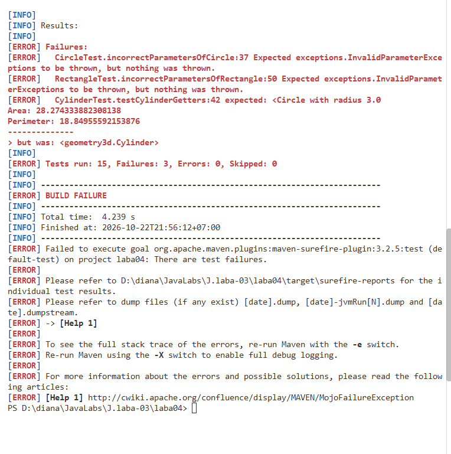

лабораторная работа 5

Сборка проекта с Maven и модульное тестирование с JUnit

Князевой Дианы Сергеевны КБ-251

Команда запуска теста: .\mvnw test 

Команда сборки и запуска JAR: .\mvnw clean package

[ERROR] RectangleTest. incorrectParametersOfRectangle:50 Expected exceptions. InvalidParameterExceptions to be thrown, but nothing was thrown.
[ERROR ]
Area: 28.274333882308138
Perimeter: 18.84955592153876

CircleTest. incorrectParametersOfCircle:37 Expected exceptions. InvalidParameterExce

CylinderTest. testCylinderGetters:42 expected: <Circle with radius 3.0

Эта ошибка произошла в процессе написания кода, когда я забыла прописать проверку ввода для бесконечности и NaN в конструкторе Rectangle. Исправила: 

